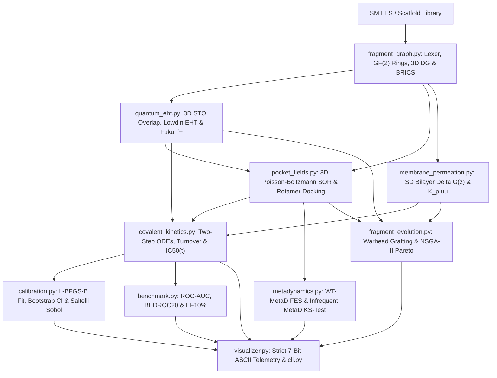

# CovaKinetix

[](https://github.com/ZengLLQ/cova-kinetix/actions/workflows/ci.yml)


**CovaKinetix** is a structure-based covalent drug discovery and quantum-kinetic simulation platform implemented in pure Python, NumPy, and SciPy. It unifies SMILES/BRICS fragment graph perception, 3D Slater-type orbital Extended Huckel Theory (EHT) condensed Fukui electrophilicity, 3D linearized Poisson-Boltzmann protein pocket electrostatics with induced-fit rotamer and Burgi-Dunitz trajectory alignment, stiff two-step covalent occupancy PK/PD ODEs, Well-Tempered and Infrequent Metadynamics rare-event unbinding kinetics, Inhomogeneous Solubility-Diffusion (ISD) lipid bilayer permeability, and NSGA-II multi-objective fragment evolution.

---

## System Architecture



### Module Dependency Map

| Module | Primary Responsibility | Key Classes & Entry Points |
| :--- | :--- | :--- |
| `cova_kinetix.types` | Periodic/STO tables, warheads, nucleophiles, dataclasses | `ELEMENT_PARAMS`, `WARHEAD_TEMPLATES`, `MolecularGraph`, `EHTResult` |
| `cova_kinetix.fragment_graph` | SMILES parser, GF(2) rings, 3D distance geometry, BRICS | `parse_smiles`, `cleave_brics`, `graft_warhead`, `embed_3d_coordinates` |
| `cova_kinetix.quantum_eht` | 3D STO prolate-spheroidal integrals, EHT, Fukui, GSH $t_{1/2}$ | `run_extended_huckel`, `build_eht_matrices`, `compute_eht_activation_barrier` |
| `cova_kinetix.pocket_fields` | 3D Linearized PB Red-Black SOR solver & Burgi-Dunitz docking | `build_target_pocket`, `solve_poisson_boltzmann_grid`, `align_covalent_ligand` |
| `cova_kinetix.membrane_permeation` | ISD lipid bilayer $\Delta G(z)$, $D(z)$, pH trapping, $K_{p,uu}$ | `simulate_membrane_permeation`, `compute_neutral_fraction` |
| `cova_kinetix.covalent_kinetics` | Stiff Radau two-step covalent PK/PD ODEs & $IC_{50}(t)$ | `simulate_covalent_kinetics`, `barrier_to_eyring_rate`, `estimate_time_dependent_ic50` |
| `cova_kinetix.metadynamics` | 2D WT-MetaD FES reconstruction & Infrequent MetaD KS test | `run_well_tempered_metadynamics`, `construct_unbinding_potential` |
| `cova_kinetix.fragment_evolution` | Multi-objective warhead/scaffold NSGA-II Pareto optimizer | `evolve_covalent_ligands`, `fast_non_dominated_sort`, `assign_crowding_distance` |
| `cova_kinetix.calibration` | L-BFGS-B kinetic calibration, bootstrap CI, Saltelli Sobol | `calibrate_kinetics_and_sensitivity` |
| `cova_kinetix.benchmark` | Multi-target screening ROC-AUC, BEDROC, EF10%, Spearman $\rho$ | `screen_compound_library`, `run_benchmark_suite` |
| `cova_kinetix.pipeline` | End-to-end orchestration & JSON telemetry serialization | `run_full_characterization`, `FullCharacterizationResult` |
| `cova_kinetix.visualizer` | Strict 7-bit ASCII plots, contour maps, and tables | `render_eht_summary`, `render_pocket_slice_contour`, `render_metadynamics_fes` |
| `cova_kinetix.cli` | 8-subcommand `argparse` interface (`cova-kinetix`) | `build_parser`, `main` |

---

## Mathematical Formulations & Physical Laws

### 1. 3D Slater-Type Orbital Extended Huckel Theory & Condensed Fukui Reactivity

For every heavy atom and VSEPR-expanded hydrogen, valence Slater-type orbitals $\chi_{n,l,m}(\mathbf{r}) = N_{n,\zeta} r^{n-1} e^{-\zeta r} Y_{lm}(\theta, \phi)$ are evaluated in prolate spheroidal coordinates $(\xi, \eta, \phi)$ with shifted Gauss-Laguerre ($t = \frac{R}{2}(\zeta_A + \zeta_B)(\xi - 1)$) and Gauss-Legendre ($\eta \in [-1,1]$) quadrature. Diatomic overlap blocks rotate analytically into the 3D molecular frame via $SO(3)$-invariant outer products:

$$S_{\mathbf{p}_A \mathbf{p}_B} = S_{\sigma\sigma} \hat{\mathbf{u}}_{AB} \hat{\mathbf{u}}_{AB}^T + S_{\pi\pi} \left(\mathbf{I}_3 - \hat{\mathbf{u}}_{AB} \hat{\mathbf{u}}_{AB}^T\right)$$

The Wolfsberg-Helmholz Hamiltonian and Lowdin symmetric orthogonalization solve:

$$H_{\mu\nu} = \frac{1}{2} K_{\text{WH}} \left(H_{\mu\mu} + H_{\nu\nu}\right) S_{\mu\nu}, \quad K_{\text{WH}} = 1.75, \qquad \left(S^{-1/2} H S^{-1/2}\right) C' = C' \boldsymbol{\varepsilon}$$

From the closed-shell density matrix $P = 2 C_{\text{occ}} C_{\text{occ}}^T$, electron conservation $\operatorname{Tr}(PS) = N_{\text{val}}$ holds to machine precision. Global Parr electrophilicity $\omega = \mu^2 / (2\eta)$ and atom-condensed Fukui electrophilic susceptibility $f_A^+$ identify nucleophilic attack hotspots on covalent warheads:

$$f_A^+ = \sum_{\mu \in A} c_{\mu,\text{LUMO}} (S c_{\text{LUMO}})_\mu, \qquad \Delta f_A = f_A^+ - f_A^-$$

### 2. 3D Linearized Poisson-Boltzmann Electrostatics & Burgi-Dunitz Alignment

The pocket electrostatic potential $\phi(\mathbf{r})$ (in units of $k_B T / e$) satisfies the variable-dielectric linearized Poisson-Boltzmann equation discretized via harmonic face-averaged fluxes and solved by Red-Black Successive Over-Relaxation ($\omega = 1.68$):

$$-\nabla \cdot \left(\varepsilon(\mathbf{r}) \nabla \phi(\mathbf{r})\right) + \varepsilon(\mathbf{r}) \kappa^2(\mathbf{r}) \phi(\mathbf{r}) = 4\pi \ell_B^{\text{vac}} \rho(\mathbf{r})$$

Across each discrete $\chi_1$ rotamer of the catalytic nucleophile ($\text{Cys}/\text{Lys}/\text{Ser}$), rigid-body pose optimization minimizes non-covalent binding free energy $\Delta G_{\text{bind}}$ (steric, H-bond, hydrophobic, PB electrostatic, and TPSA desolvation) jointly with the Burgi-Dunitz pre-reaction attack trajectory ($d_{\text{Nu}-\text{C}_{\text{elec}}} \approx 3.35\,\text{\AA}$, $\theta_{\text{BD}} \approx 107^\circ$).

### 3. Two-Step Covalent Engagement & Cellular Target Turnover ODEs

Reversible encounter and covalent bond formation couple to protein turnover ($k_{\text{syn}} = k_{\text{deg}} E_0$), competitive intracellular substrate ($1 + [S]/K_m$), plasma dosing $C_p(t)$, intracellular partitioning $K_{p,uu}$, and off-target glutathione scavenging $k_{\text{GSH}}$:

$$E + I \underset{k_{\text{off}}}{\overset{k_{\text{on}}}{\rightleftharpoons}} E \cdot I \underset{k_{\text{rev}}}{\overset{k_{\text{inact}}}{\rightleftharpoons}} E - I, \qquad k_{\text{inact}} = \frac{k_B T}{h} \exp\!\left(-\frac{\Delta G^{\ddagger}_{\text{eff}}}{R T}\right)$$

where $\Delta G^{\ddagger}_{\text{eff}}$ integrates warhead barrier, EHT local electrophilicity $\omega f_k^+$, and Henderson-Hasselbalch nucleophile ionization fraction $f_{\text{Nu}} = (1 + 10^{\mathrm{p}K_a - \mathrm{pH}})^{-1}$.

### 4. Well-Tempered & Infrequent Metadynamics Kinetics

Overdamped Langevin dynamics on 2D collective variables $(s_1, s_2)$ deposits history-dependent Gaussian bias hills with Well-Tempered tempering factor $\gamma = (T + \Delta T)/T$:

$$V_{\text{bias}}(\mathbf{s}, t) = \sum_{t' < t} W_0 \exp\!\left(-\frac{V_{\text{bias}}(\mathbf{s}(t'), t')}{k_B \Delta T}\right) \exp\!\left(-\sum_{i=1}^2 \frac{(s_i - s_i(t'))^2}{2\sigma_i^2}\right)$$

Unbiased free energies follow $F(\mathbf{s}) = -\frac{\gamma}{\gamma - 1} V_{\text{bias}}(\mathbf{s})$. In Infrequent Metadynamics mode, Tiwary-Parrinello rescaled unbinding times $t_{\text{phys}} = \int_0^{\tau} \exp(\beta V_{\text{bias}}(\mathbf{s}(t')))\,dt'$ are validated against an exponential Poisson distribution via a Kolmogorov-Smirnov test ($p \ge 0.05$).

### 5. Inhomogeneous Solubility-Diffusion (ISD) Bilayer Permeability

Transmembrane effective permeability $P_{\text{eff}}$ is integrated across $z \in [-30, +30]\,\text{\AA}$ combining Born/TPSA desolvation, $\log P$ acyl partitioning, headgroup dipole stabilization, cavity work, and position-dependent micro-viscosity diffusivity $D(z)$:

$$\frac{1}{P_{\text{eff}}^{\text{intr}}} = \int_{-L/2}^{+L/2} \frac{\exp(\beta \Delta G(z))}{D(z)}\, dz, \qquad P_{\text{eff}} = f_{\text{neutral}}(\mathrm{pH}) \cdot P_{\text{eff}}^{\text{intr}}$$

---

## Installation & Quick Start

```bash
git clone https://github.com/ZengLLQ/cova-kinetix.git
cd cova-kinetix
pip install -e .[dev]
```

### CLI Reference (8 Subcommands)

```bash
# 1. End-to-end covalent ligand characterization + ASCII plots + optional JSON export
cova-kinetix demo --target EGFR_C797S --metad-steps 1200 --seed 42

# 2. Extended Huckel quantum chemistry & condensed Fukui reactivity
cova-kinetix quantum --smiles "C=CC(=O)Nc1ccccc1" --name Acrylanilide

# 3. Virtual library screening against a catalytic pocket
cova-kinetix screen --target BTK_C481 --top-k 10

# 4. Inhomogeneous Solubility-Diffusion membrane permeation profile
cova-kinetix permeate --smiles "C=CC(=O)Nc1ccc(NCc2ccccc2)cc1" --ph 7.4

# 5. Well-Tempered & Infrequent Metadynamics unbinding simulation
cova-kinetix metad --dg-bind -8.2 --barrier-extra 5.2 --steps 2000 --n-trajectories 8

# 6. NSGA-II multi-objective covalent fragment & warhead evolution
cova-kinetix evolve --target EGFR_C797S --generations 4 --pop-size 14

# 7. Kinetic calibration, bootstrap CI, and Saltelli Sobol sensitivity
cova-kinetix calibrate --n-bootstrap 20 --n-sobol 48

# 8. Multi-compound covalent enrichment benchmark (ROC-AUC, BEDROC20, EF10%)
cova-kinetix benchmark --target EGFR_C797S
```

### Python SDK Walkthrough

```python
from cova_kinetix.pipeline import run_full_characterization
from cova_kinetix.visualizer import render_eht_summary, render_covalent_kinetics

res = run_full_characterization(
    smiles="C=CC(=O)Nc1cc(Nc2nccc(-c3cn(C)c4ccccc34)n2)c(OC)cc1N(C)CCN(C)C",
    target_name="EGFR_C797S",
    ligand_name="Osimertinib_analog",
)
print(render_eht_summary(res.molecule, res.eht))
print(render_covalent_kinetics(res.kinetics))
```

### Sample 7-Bit ASCII Terminal Output

```text
=== Extended Huckel Quantum Reactivity: Acrylanilide ===
Warhead       : acrylamide (Electrophile atom #0)
Basis / e-    : 49 STOs | 56 valence e- (Tr(PS)=56.0000)
HOMO / LUMO   : -11.314 eV / -9.012 eV  (Gap = 2.302 eV)
Global CDFT   : mu=-10.163 eV | eta=1.151 eV | omega=44.864 eV
GSH Stability : t1/2 = 91.4 min  | Hyper-reactive = False

Top Electrophilic Heavy Atoms (Condensed Fukui f+):
Idx  Sym   q_Mulliken   f+ (Nu-atk)   f- (El-atk)   Dual df    Bar
--------------------------------------------------------------------------
  0* C      -0.0642       0.1942        0.0418     +0.1524   [##################]
```

---

## Verification & Quality Gates

Run the full verification pipeline locally:

```bash
python -m compileall -q src tests examples
flake8 src tests examples --max-line-length=120 --extend-ignore=E203
mypy src
pytest -v
```

---

## Scope & Limitations

- **Semi-Empirical Quantum Level**: Extended Huckel Theory provides non-iterative MO eigenvalues, Mulliken/Lowdin populations, and condensed Fukui indices without self-consistent field (SCF) electron correlation or implicit solvent polarization.
- **Coarse-Atom Pocket Grids**: Target pockets represent canonical hinge/catalytic functional groups with discrete $\chi_1$ nucleophile rotamers rather than full-atom MD receptor ensembles.
- **Research & Simulation Only**: All kinetic, permeability, and reactivity predictions are computational research tools and are not validated for clinical or regulatory decision-making.
